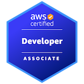
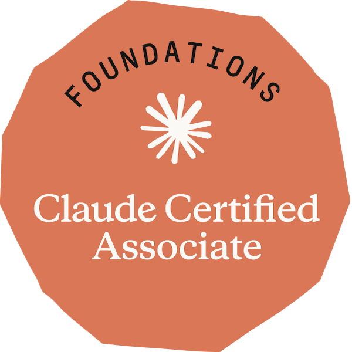

# Hi, I'm Aditya Kumar 

### SDET | QA Automation Engineer | Cloud & DevOps | AI-Powered Quality Engineering

**Building scalable test automation frameworks, reliable engineering solutions, and intelligent quality workflows.**

I'm a Quality Engineering professional specializing in **Java-based test automation, UI and API testing, automation framework development, and CI/CD integration**.

My experience includes developing reusable testing utilities, enhancing automation frameworks, implementing parallel execution, and improving test reporting and engineering efficiency.

Beyond traditional automation, I'm expanding my capabilities across **AWS, DevOps, Claude, AI Agents, and Model Context Protocol (MCP)**, with a focus on bringing AI-powered solutions into modern software engineering.

---

## 💼 What I Do

- **Test Automation:** Develop and maintain reliable UI and API automation solutions using Java, Selenium, Playwright, and REST Assured.
- **Framework Engineering:** Build modular, maintainable frameworks with reusable utilities, parallel execution, and reporting capabilities.
- **Quality Engineering:** Improve testing practices, framework reliability, and integration with CI/CD workflows.
- **Cloud & DevOps:** Apply AWS and DevOps knowledge to engineering and automation challenges.
- **AI-Assisted Engineering:** Use tools such as Claude, GitHub Copilot, and Kiro while exploring intelligent testing workflows.

## 🛠️ Technical Expertise

| Domain | Technologies & Capabilities |
|---|---|
| **Programming** | Java |
| **UI Automation** | Selenium WebDriver, Playwright |
| **API Automation** | REST Assured, REST API Testing |
| **Test Frameworks** | TestNG, Maven, BDD |
| **Automation Architecture** | Page Object Model, Data-Driven Testing, Parallel Execution |
| **CI/CD & Version Control** | Git, GitHub Actions, CI/CD Pipelines |
| **Cloud & DevOps** | AWS, Docker, Kubernetes |
| **AI & Developer Tools** | Claude, GitHub Copilot, Kiro |
| **Quality Engineering** | Framework Enhancements, Test Reporting, Reusable Libraries, Test Strategy |
| **Currently Exploring** | AI Agents, MCP, AI-Powered Test Automation, FDE |

---

## 🏆 Professional Certifications

  
  &nbsp;&nbsp;&nbsp;&nbsp;
  

  <strong>AWS Certified Developer – Associate</strong>
  &nbsp;&nbsp; | &nbsp;&nbsp;
  <strong>Claude Certified Associate – Foundations</strong>

  <a href="https://www.credly.com/badges/5a88693e-91cf-4160-8494-c3d8772c2b4c/public_url">Verify AWS Certification</a>
  &nbsp;&nbsp; | &nbsp;&nbsp;
  <a href="https://www.credly.com/badges/9dcf0d3b-7d70-4402-9e3b-83b8a2042ff1/public_url">Verify Claude Certification</a>

These certifications support my continued development in **cloud engineering, AI technologies, and modern software delivery**.

---

## 🚀 Engineering Contributions

### 🧪 Automation Framework Engineering

- Enhanced reusable UI and API automation frameworks for maintainability and scalability.
- Developed common testing utilities and reporting libraries.
- Improved execution efficiency through parallel test execution.
- Contributed to CI/CD pipeline integration and automated quality checks.
- Supported database testing utilities and reusable validation practices.

### ☁️ Cloud & DevOps

- Developed knowledge of AWS application development and serverless services.
- Exploring containerized test execution and cloud-native engineering practices.
- Strengthening CI/CD, Docker, and Kubernetes skills for automation workflows.

### 🤖 AI-Powered Quality Engineering

- Exploring Claude-based agents for intelligent testing and automation.
- Learning MCP integrations connecting AI agents with browser automation, APIs, and databases.
- Investigating AI-assisted test generation, debugging, reporting, and workflow optimization.
- Applying AI developer tools to improve engineering productivity.

---

## 📂 Technical Portfolio

I'm developing a portfolio of practical engineering implementations covering test automation, cloud technologies, and AI.

| Project Area | Engineering Focus |
|---|---|
| **Java & Selenium Automation** | Modular UI automation and reusable framework components |
| **Playwright Automation** | Modern browser automation and reliable test execution |
| **REST Assured API Testing** | API validation, reusable clients, and automated testing |
| **AI-Powered QA Agents** | Claude, MCP, and intelligent automation workflows |
| **AWS & DevOps Labs** | AWS services, containers, and CI/CD practices |

*Project repositories and implementation links will be added as they are published.*

---

## 📚 Learning & Development

Currently focused on:

- **AI Engineering:** Claude, AI agents, MCP, and tool integrations.
- **Automation Architecture:** Scalable frameworks and intelligent test automation.
- **Cloud Engineering:** AWS development and cloud-native applications.
- **DevOps:** Docker, Kubernetes, and CI/CD automation.
- **Forward Deployed Engineering:** Applying AI and software engineering to real-world problems.

---

## 🤝 Let's Connect

I'm interested in collaborating on **Test Automation, Quality Engineering, Cloud & DevOps, and AI-powered Engineering Solutions**.

I value continuous learning, practical implementation, and building reliable, scalable, and maintainable engineering solutions.

**Thanks for visiting my GitHub profile!**
